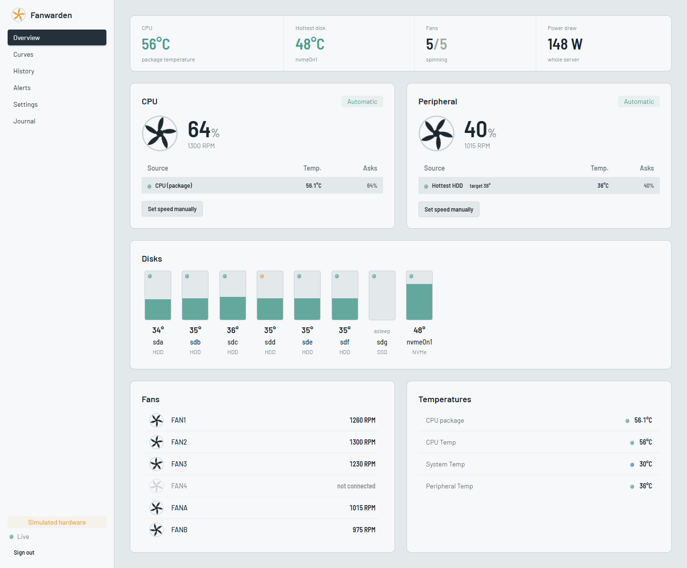
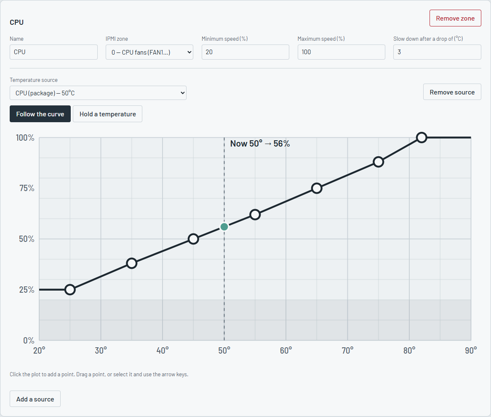
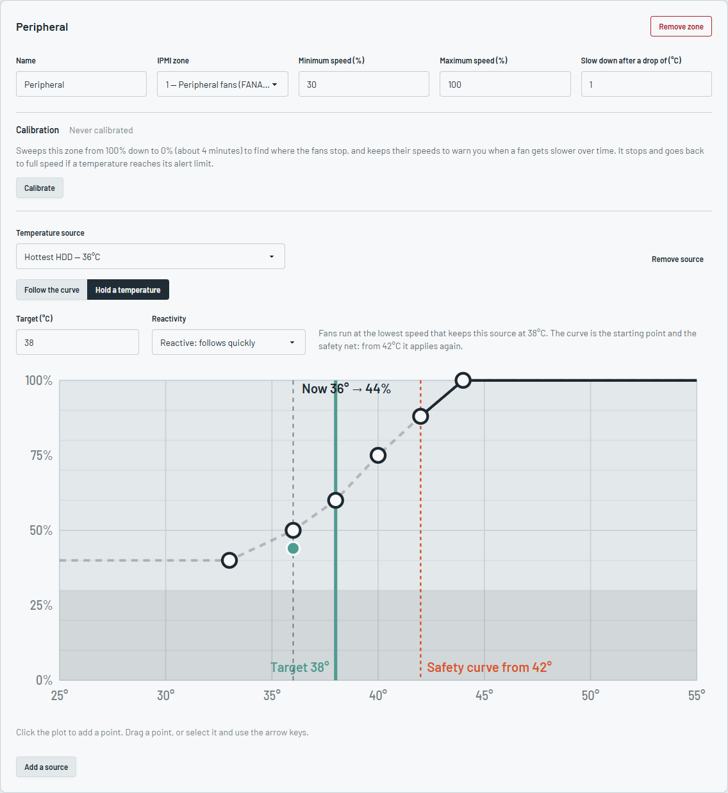
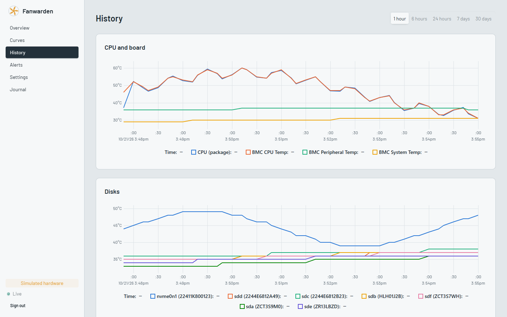

# fanwarden

Fan control for Supermicro motherboards through IPMI, driven by CPU and disk temperatures, with a web UI.

A single static binary: no Python, no runtime to install. Tested on H11SSL; it should work on every board
that accepts the X10/X11/X12/H11/H12 fan commands (`raw 0x30 0x70 0x66`).

## What it does

- Reads the CPU temperature (hwmon: `k10temp`, `zenpower`, `coretemp`), every disk through SMART
  (`smartctl --json`, without waking sleeping disks) and the BMC sensors.
- Drives each IPMI zone (0 = `FAN1…`, 1 = `FANA…`) from one or more sources, each with its own curve.
  The zone runs at the highest speed its sources ask for, with hysteresis and min/max limits.
- If a source cannot be read, the zone goes to the failsafe speed (100% by default). When the service
  stops or crashes, fans are handed back to the BMC.
- Disk health from SMART (self-assessment, reallocated and pending sectors, CRC and media errors, wear,
  power-on time): a colored LED on each disk bay, details on click.
- Fan calibration: sweeps a zone from 100% to 0% to find where the fans stop and suggest a minimum
  speed, then keeps the speeds as a reference to warn when a fan gets slower (dust, wear). It stops and
  goes back to full speed if a temperature reaches its alert limit.
- Web UI: live overview, curve editor, history (SQLite), manual speed, alerts, settings, journal.
- Configuration history: the last 20 versions with what changed in each (secrets hidden), and a
  button to go back to any of them (Journal page).
- BMC hardware event log (memory errors, power supplies, chassis intrusion, thresholds crossed) in the
  Journal, with an alert for each new warning or failure.
- Alerts (hot CPU or disk, stopped or slowing fan, failing disk or SMART errors going up, BMC
  hardware event, unreachable BMC) sent to Discord, ntfy, Gotify or any webhook.
- Prometheus metrics on `/metrics`.
- Local BMC (`/dev/ipmi0`) or remote BMC over the network (IPMI over LAN).

## Screenshots

<picture>
  <source media="(prefers-color-scheme: dark)" srcset="docs/screenshots/overview-dark.png">
  
</picture>

Curve editor: a zone follows its curve…

<picture>
  <source media="(prefers-color-scheme: dark)" srcset="docs/screenshots/curves-follow-dark.png">
  
</picture>

…or holds a temperature (here the disks at 38°C), with the curve as a safety net:

<picture>
  <source media="(prefers-color-scheme: dark)" srcset="docs/screenshots/curves-target-dark.png">
  
</picture>

History:

<picture>
  <source media="(prefers-color-scheme: dark)" srcset="docs/screenshots/history-dark.png">
  
</picture>

## Install

Requirements on the server: `ipmitool`, `smartmontools`, `lsblk` (already present on TrueNAS SCALE).

```bash
# Debian / Proxmox
sudo apt install ipmitool smartmontools
curl -fsSLO https://raw.githubusercontent.com/SeiyaGame/fanwarden/main/install.sh
sudo bash install.sh

# TrueNAS SCALE: install on a pool, the boot pool is replaced on updates
sudo bash install.sh --dir /mnt/tank/apps/fanwarden
```

To try the next version before its release, `install.sh --dev` installs the `dev` pre-release, rebuilt
from the main branch on every change (`ghcr.io/seiyagame/fanwarden:dev` for Docker).

Then open `http://<server>:9495` and choose the web password. The configuration is in `config.toml`
next to the binary; everything can be changed from the UI. `config.example.toml` is a complete example
(curves tuned to keep hard drives at or below ~40°C). After editing the file by hand, use *Reload the
configuration file* in Settings: no restart needed.

On TrueNAS, add the command printed by the installer as a *Post Init* script (System › Advanced ›
Init/Shutdown Scripts) so the service is recreated after a TrueNAS update.

### Docker

```bash
curl -fsSLO https://raw.githubusercontent.com/SeiyaGame/fanwarden/main/docker-compose.yml
docker compose up -d
```

Images are published on `ghcr.io/seiyagame/fanwarden`: `latest` and `X.Y.Z` for releases,
`dev` for the main branch. To build the image yourself: `docker build -t fanwarden .`

| Variable | Default | |
| -------- | ------- | - |
| `PUID` / `PGID` | `1000` | Owner of the files in `/data` (config, history) |
| `RUN_AS_ROOT` | `true` | `false` enables the hardened mode below |
| `TZ` | | Time zone of the logs |

By default the container runs as root, privileged, with the host `/dev`: the BMC and every disk are
found without any setup. A privileged container is close to root on the host.

#### Hardened mode

fanwarden runs as `PUID:PGID` in an unprivileged container that only receives the BMC, the disks
and the capabilities SMART needs. The entrypoint gives `abc` access to the devices passed in
`devices:` (the container's own copies: the host is not changed) and grants smartctl the capabilities
allowed by `cap_add`.

Example: [`docker-compose.hardened.yml`](docker-compose.hardened.yml). List your BMC and disks under
`devices:`, then:

```bash
docker compose -f docker-compose.hardened.yml up -d
```

Limits:

- A disk added to the server must be added to `devices:` (disks without a device in the container are
  ignored).
- NVMe SMART needs `SYS_ADMIN`, a broad capability. Without NVMe, leave it out.
- Do not mount `/dev` as a volume in this mode: the entrypoint refuses to start rather than change the
  permissions of the host devices.
- With a remote BMC, `/dev/ipmi0` is not needed; without disk monitoring, neither are the disks and
  `cap_add`.

## Command line

```
fanwarden [--config FILE] [--dry-run] [--simulate] [--listen ADDR]
fanwarden set-password      # reset the web password (read from stdin)
fanwarden check-config      # validate the configuration
fanwarden healthcheck       # exit 0 if the service answers (used by the Docker image)
```

- `--dry-run`: read and compute, never write to the BMC.
- `--simulate`: fake BMC and sensors, to try the UI on any Linux machine.

Logs go to the journal (`journalctl -u fanwarden -f`); the last 1000 events are also in the UI.

## Development

| Tool | Version |
| ---- | ------- |
| Rust | stable (≥ 1.88), target `x86_64-unknown-linux-musl` for releases |
| Node | 24 |

```bash
# Backend with fake hardware
cargo run -- --simulate --config ./dev-config.toml --listen 127.0.0.1:9495

# UI with hot reload (proxies the API to the backend above)
cd web && npm ci && npm run dev

# Static release binary (UI embedded)
cd web && npm run build && cd .. && cargo build --release --target x86_64-unknown-linux-musl
```

Quality checks run before each commit and in CI:

```bash
git config core.hooksPath .githooks   # once per clone
scripts/check.sh                      # fmt, clippy, tests, eslint, prettier, svelte-check, vitest
```

On Windows, the hook runs the Rust checks inside WSL when `cargo` is not on the Windows `PATH`.

The CI also checks the minimum Rust version (`rust-version`), the licenses and sources of the crates
(`cargo deny check`, see `deny.toml`), the security advisories, the workflows (actionlint) and that the
Docker image builds. Dependabot opens weekly updates (crates, npm, actions, base images): minor and
patch updates are merged automatically once the CI passes, majors wait for a review.

### Layout

```
src/
  main.rs         command line, startup, shutdown and panic handling
  controller.rs   control loop: read sensors, compute duties, apply them
  curve.rs        curves and hysteresis
  ipmi.rs         ipmitool commands and `sdr` parsing
  sensors/        hwmon, disks (lsblk + smartctl), temperature sources
  alerts.rs       alert detection;  notify.rs  notification channels
  history.rs      SQLite time series
  web/            HTTP API, authentication, Prometheus metrics, embedded UI
  sim.rs          simulated hardware
web/              Svelte 5 + TypeScript UI
tests/api.rs      HTTP API tests
```

Releases: push a `v*` tag, CI builds the static binary, attaches it to the GitHub release and writes
the release notes from the commits since the previous tag ([git-cliff](https://git-cliff.org), see
`cliff.toml`). Commits follow [Conventional Commits](https://www.conventionalcommits.org): `feat:`,
`fix:`, `perf:`, `refactor:`, `docs:`, `build:`/`ci:`, `chore:`. PRs are squash-merged, so their
title must follow the same format (checked by the CI).

## License

GPL-3.0
